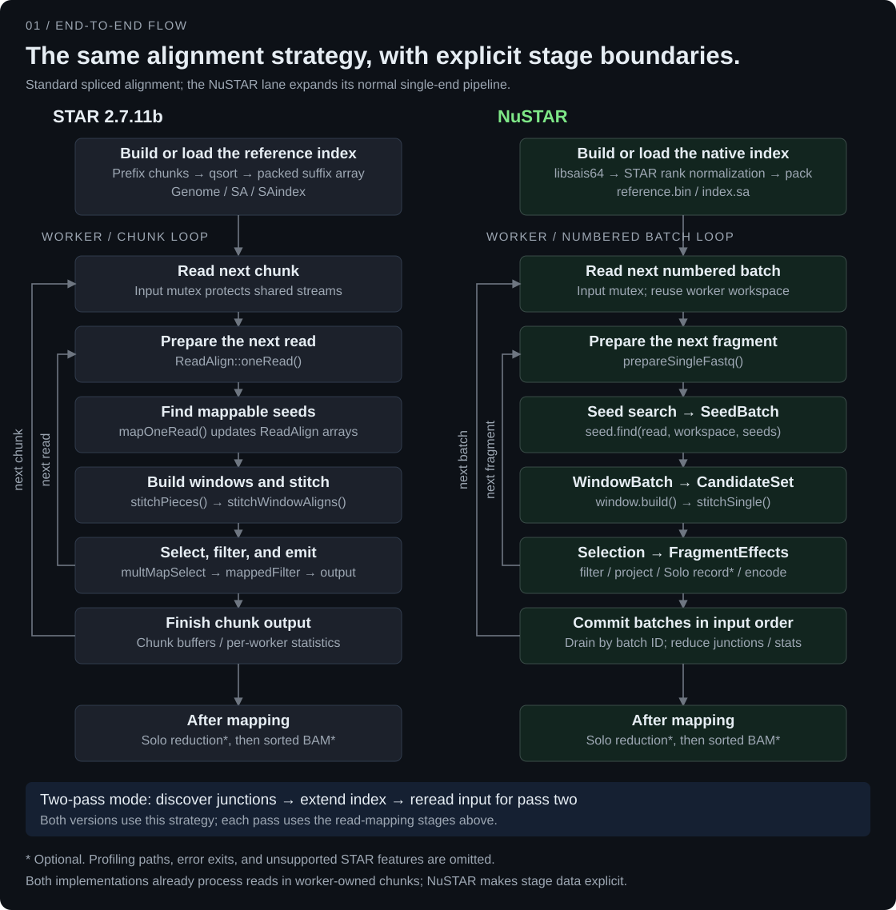
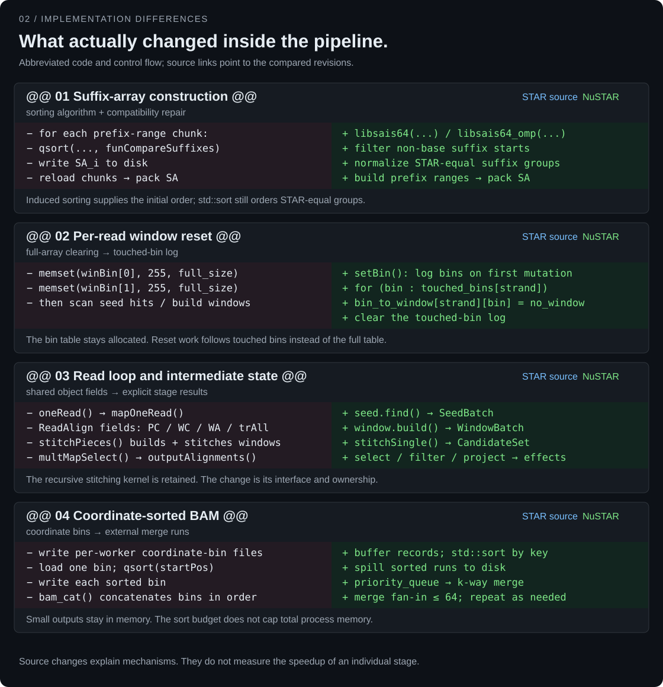

# STAR and NuSTAR: flow and implementation differences

[Back to the README](../readme.md#implementation-status) · [Code guide](../CODE_STRUCTURE.md) · [Benchmark status](BENCHMARKS.md)

This comparison reads STAR **2.7.11b**, revision [`b1edc12`](https://github.com/alexdobin/STAR/tree/b1edc1208d91a53bf40ebae8669f71d50b994851), against NuSTAR revision [`bdf6bfa`](https://github.com/BioCode-Commons/NuSTAR/tree/bdf6bfa7d465c965edac091c6f13d292a81be1ef). The figures show specific mechanisms found in those sources. The abbreviated code below describes control flow; it is not a patch that can be applied between the repositories.

## End-to-end flows



Both implementations already process reads in worker-owned chunks and perform seed search, window construction, stitching, selection, and output. NuSTAR makes intermediate results and workspace ownership explicit. Splitting these interfaces does not by itself change the alignment algorithm.

The NuSTAR lane expands the normal single-end path through `runOrderedAlignment`; it is not a diagram of the separate profiling implementation. Its paired-end pipeline uses corresponding typed mapping stages and handles mate overlap as well. Error exits and STAR workflows outside NuSTAR's supported scope are omitted.

- **STAR control flow:** [chunk processing](https://github.com/alexdobin/STAR/blob/b1edc1208d91a53bf40ebae8669f71d50b994851/source/ReadAlignChunk_processChunks.cpp#L11), [per-read processing](https://github.com/alexdobin/STAR/blob/b1edc1208d91a53bf40ebae8669f71d50b994851/source/ReadAlign_oneRead.cpp#L78-L111), and [seed search followed by window/stitch processing](https://github.com/alexdobin/STAR/blob/b1edc1208d91a53bf40ebae8669f71d50b994851/source/ReadAlign_mapOneRead.cpp#L34-L118).
- **NuSTAR control flow:** [normal single-end runtime](../runtime/single_alignment.cpp), [ordered batch loop](../runtime/ordered_alignment.cpp), [candidate mapping composition](../pipeline/single_end/mapping_composition.cpp), and [selection, projection, and effects](../pipeline/single_end/pipeline.cpp).
- **Finalization:** STAR finishes Solo counting before [coordinate BAM sorting](https://github.com/alexdobin/STAR/blob/b1edc1208d91a53bf40ebae8669f71d50b994851/source/STAR.cpp#L255-L272); NuSTAR calls `solo_session->finish()` before `sink->finalize()` in its single-end and paired-end runtimes.
- **Two-pass:** both discover junctions, extend their respective indexes, and remap the input. See STAR's [pass-one coordinator](https://github.com/alexdobin/STAR/blob/b1edc1208d91a53bf40ebae8669f71d50b994851/source/twoPassRunPass1.cpp) and NuSTAR's [two-pass coordinator](../runtime/two_pass.cpp).

## Implementation differences



### 1. Suffix-array construction

**STAR:** count prefix ranges, divide them into chunks, collect suffix offsets for each chunk, call `qsort` with `funCompareSuffixes`, and write the sorted chunk to a temporary `SA_i` file. Read those chunks back in order and pack the suffix array. The comparator includes STAR's finite comparison length and chromosome-padding behavior.

**NuSTAR:** the default production path calls `libsais64` or its OpenMP variant to construct the initial suffix order. It removes suffix starts that are not ordinary bases, normalizes STAR-equivalent groups, packs and releases the temporary suffix positions, then builds prefix ranges for the native index. Normalization still uses `std::sort` within groups that STAR treats as equal, ordered by the translated STAR coordinate. Replacing initial suffix construction therefore does not remove all comparison sorts from the builder.

```text
STAR:    prefix chunks → qsort(custom suffix comparator) → disk chunks → pack
NuSTAR:  libsais64 → filter starts → normalize STAR ranks → pack/release → prefix ranges
```

The distinction matters for compatibility: a plain lexicographic suffix order is not sufficient to reproduce every STAR rank choice. NuSTAR also retains a separate 32-bit builder interface; `index/sais.cpp` is not the default production path shown here. The two programs' binary index formats remain different.

Sources: [STAR chunk construction and qsort](https://github.com/alexdobin/STAR/blob/b1edc1208d91a53bf40ebae8669f71d50b994851/source/Genome_genomeGenerate.cpp#L213-L325), [NuSTAR's default builder route](../index/suffix_array_index.cpp), [libsais64 call](../index/wide_suffix_array.cpp), and [STAR rank normalization](../index/star_rank.cpp).

### 2. Per-read window reset

**STAR:** `stitchPieces()` begins with two `memset` calls covering all `winBinN` entries of the strand-specific bin-to-window tables.

**NuSTAR:** the tables are allocated when the worker workspace is created. `setBin()` logs a bin when it first changes from `no_window` to an assigned window. `reset()` walks these `touched_bins`, restores them to `no_window`, and clears the log. Updating an already assigned bin does not add another log entry.

```text
STAR:    reset every bin on both strands → build this read's windows
NuSTAR:  reset logged bins → clear the log → log this read's first bin mutations
```

If the table has B entries and the previous read touched T of them, the reset visits the full table in STAR and the touched entries in NuSTAR. This changes the amount of clearing work, not the window-selection rules or the allocation size of the bin table. No isolated reset-time measurement is provided here.

Sources: [STAR full-table reset](https://github.com/alexdobin/STAR/blob/b1edc1208d91a53bf40ebae8669f71d50b994851/source/ReadAlign_stitchPieces.cpp#L12-L16), [NuSTAR workspace initialization and touched-bin reset](../window/star_window.cpp), and [existing workspace-reuse regression cases](../tests/window/workspace_reuse.cpp).

### 3. Read loop and intermediate state

**STAR:** a worker's `ReadAlignChunk` loops over reads. `ReadAlign::oneRead()` calls mapping, selection, filtering, and output methods on its `ReadAlign` object. `mapOneRead()` fills seed-related fields; `stitchPieces()` reads those fields to construct windows and stitch candidates. Arrays and members such as `PC`, `WC`, `WA`, and `trAll` connect the steps.

**NuSTAR:** the worker creates reusable stage workspaces, then calls the composed pipeline for each fragment. The candidate mapper passes a `SeedBatch` into the window builder, receives a `WindowBatch`, and passes it into the stitcher to produce a `CandidateSet`. The outer pipeline performs selection, filtering, record projection, and junction/statistic derivation, returning `FragmentEffects`. Input access, encoding, and commit order are handled by the runtime and sink interfaces.

```text
STAR:    oneRead → mapOneRead → stitchPieces → selection/filter/output
         intermediate state lives in ReadAlign fields

NuSTAR:  find → SeedBatch → build → WindowBatch → stitch → CandidateSet
         outer pipeline → FragmentEffects → sink / ordered commit
```

The read loop still exists. The recursive `stitchWindowAligns()` kernel is also retained and adapted; its source explicitly preserves branch order, score arithmetic, and candidate tie rules. The change shown here is the boundary and ownership of each stage, not a replacement of recursive stitching with a new algorithm.

Sources: [STAR per-read calls](https://github.com/alexdobin/STAR/blob/b1edc1208d91a53bf40ebae8669f71d50b994851/source/ReadAlign_oneRead.cpp#L78-L111), [STAR seed/window connection](https://github.com/alexdobin/STAR/blob/b1edc1208d91a53bf40ebae8669f71d50b994851/source/ReadAlign_mapOneRead.cpp#L34-L118), [NuSTAR candidate mapper](../pipeline/single_end/mapping_composition.cpp), [outer pipeline](../pipeline/single_end/pipeline.cpp), [ordered commit](../runtime/ordered_alignment.cpp), and [retained stitching kernel](../stitching/stitch_window.cpp).

### 4. Coordinate-sorted BAM

**STAR:** mapping writes temporary coordinate-bin files per worker. For a mapped bin, `BAMbinSortByCoordinate()` loads the bin's data, extracts coordinate/read-order keys and byte offsets into `startPos`, and uses `qsort`. It writes each sorted bin, then `bam_cat()` concatenates the bins in coordinate order. Unmapped records use a separate sorting path. The sorting coordinator checks that the largest mapped bin fits its configured memory budget.

**NuSTAR:** `bam/sink.cpp` accumulates records and calls `std::sort` before spilling an ordered run to disk. A priority queue holds the current head of each run for a k-way merge. Merge fan-in is limited to 64; more runs are combined in additional passes. If no spill was needed, finalization sorts the remaining records in memory and writes them directly.

```text
STAR:    coordinate bins → load a bin → qsort → sorted bin files → concatenate
NuSTAR:  record buffer → std::sort → sorted runs → priority-queue merge
```

NuSTAR's sort key contains reference ID, position, input-fragment ordinal, and within-fragment record order. This makes its coordinate-tie ordering explicit. The record-buffer threshold is the smaller of the requested sort budget and 8 MiB per mapping thread; this is not a total-process memory limit. The change is the sorting and temporary-I/O strategy, not just a rename from `qsort` to `std::sort`.

Sources: [STAR per-bin sorting](https://github.com/alexdobin/STAR/blob/b1edc1208d91a53bf40ebae8669f71d50b994851/source/BAMbinSortByCoordinate.cpp#L12-L52), [STAR memory check and concatenation](https://github.com/alexdobin/STAR/blob/b1edc1208d91a53bf40ebae8669f71d50b994851/source/bamSortByCoordinate.cpp#L14-L94), and [NuSTAR record keys, run generation, merging, and finalization](../bam/sink.cpp).

## How to interpret the figures

These are source comparisons, not new performance measurements. End-to-end benchmarks cannot isolate the speed of suffix construction, bin clearing, stitching, or BAM sorting. Use the [runtime and correctness report](STAR_COMPARISON.md) for measured workloads and the scope of the output comparisons. Solo retains STAR-derived algorithms; splitting its code into modules does not mean all of those algorithms were independently redesigned.

## Changes in the updated implementation

These changes are present in `bdf6bfa`; this source review does not establish their end-to-end performance or a new real-data compatibility result.

### 5. Two-pass suffix-array merge

STAR 2.7.11b's `sjdbBuildIndex.cpp` walks the existing suffix array and inserts new junction suffixes at their ranked positions. The updated NuSTAR implementation partitions the **output ranks** into chunks of `1 << 22` entries. An insertion numbered `k` belongs at `min(insertion.rank, old_count) + k`; a binary search counts the insertions before each chunk's starting rank. That gives the chunk its old-array cursor and insertion cursor without waiting for preceding chunks.

An OpenMP loop with dynamic scheduling merges each chunk through its own `RangeWriter`. Chunk boundaries are multiples of 64 ranks, so workers do not share a byte in the packed output. Workers release consumed old-index pages; a final discard handles pages shared by neighboring chunks. This changes the merge structure and allocation lifetime, while retaining rank-based insertion ordering. OpenMP availability and available work determine actual parallel execution; no measured speedup is claimed.

Sources: [STAR merge](https://github.com/alexdobin/STAR/blob/b1edc1208d91a53bf40ebae8669f71d50b994851/source/sjdbBuildIndex.cpp), [NuSTAR merge](../index/junction_insert.cpp), [packed range writer](../index/packed_suffix_array.hpp).

### 6. Paired-end overlap mapping

The updated NuSTAR runtime can create an `IPairedOverlapRefiner` when `peOverlapNbasesMin` is nonzero. Ordinary paired candidate mapping runs first. The helper searches mate offsets using STAR's match/mismatch rule: ambiguous bases count as mismatches, and the threshold uses mismatches divided by matches. It maps a merged sequence through a separate `ISingleCandidateMapper` workspace, projects aligned blocks back to mate coordinates, and recalculates scores before paired selection.

This is an adaptation of STAR's overlap strategy, not a newly claimed overlap algorithm. The helper does not invoke a full single-end output pipeline or consume its random selection state. Original mate sequences remain available to SAM/BAM output. `peOverlapNbasesMin` defaults to `0` (disabled), and `peOverlapMMp` to `0.01`.

The new [paired-overlap differential fixture](../tests/integration/paired_overlap.py) covers several thresholds, mismatches, ambiguous bases, indels, mate geometries, clipping, and two-pass mode at 1 and 4 threads. The fixture defines comparisons; this documentation update does not report them as freshly executed tests.

Sources: [STAR overlap mapping](https://github.com/alexdobin/STAR/blob/b1edc1208d91a53bf40ebae8669f71d50b994851/source/ReadAlign_peOverlapMergeMap.cpp), [NuSTAR helper](../pipeline/paired_end/star_overlap.cpp), [paired runtime](../runtime/paired_alignment.cpp).

### 7. Junction strand preparation

Annotation proposals are first sorted by strand group and normalized coordinates. NuSTAR then deduplicates normalized coordinates and performs a second coordinate-ordered selection pass. The updated winner rules account for proposal priority, supplied versus undefined strand, and canonical versus noncanonical motifs. In the second pass, priority is compared with the previous sorted proposal even when that proposal was skipped. Strand resolution is recorded before emitting the final entries.

These details affect which annotated junction sequence enters the index, so they can affect later seed matches and candidate selection. The source includes [strand unit fixtures](../tests/annotation/junction_strand.cpp) and a [STAR differential fixture](../tests/integration/junction_strand.py). The earlier K562 discrepancy is retained as historical evidence; it has not been rerun against this revision here, and this document does not claim it is resolved.

Sources: [STAR junction preparation](https://github.com/alexdobin/STAR/blob/b1edc1208d91a53bf40ebae8669f71d50b994851/source/sjdbPrepare.cpp), [NuSTAR junction preparation](../annotation/junction_database.cpp).

### Index construction and statistics

`PackedSuffixArray::packAndRelease` consumes temporary 64-bit positions and releases complete source pages on Linux. Prefix ranges are constructed after that temporary array is freed. The CLI also releases construction owners before reloading the persisted reference/index for verification. These are memory-lifetime changes, not current peak-RSS measurements. See [packing](../index/packed_suffix_array.cpp), [build order](../index/suffix_array_index.cpp), and [reload verification](../cli/genome_generate.cpp).

The updated [statistics collector](../statistics/star_statistics.cpp) uses clipped mate lengths for input-base counts, following STAR's convention. This changes the interpretation of statistics for clipped inputs; it is separate from the alignment-record comparison.
