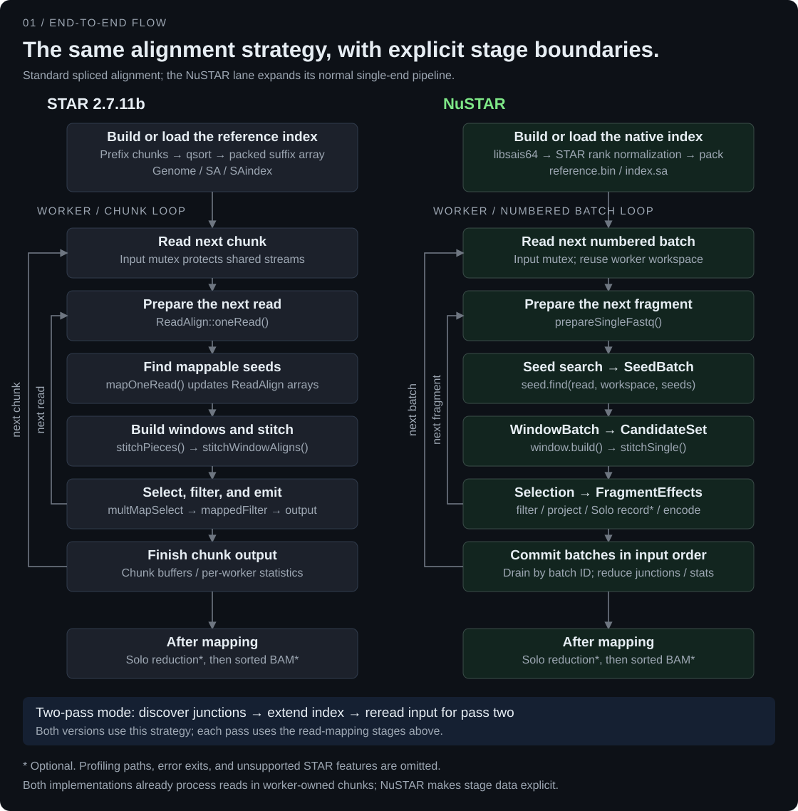
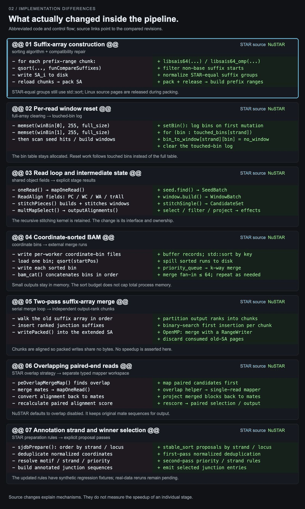

<div align="center">

# NuSTAR

**A refactored implementation of STAR for bulk and single-cell RNA-seq.**

[Quick start](#quick-start) · [Benchmarks](#benchmarks) · [Implementation](#implementation-status) · [Roadmap](#roadmap) · [Usage](docs/USAGE.md) · [Contributing](CONTRIBUTING.md)

</div>

---

NuSTAR reimplements STAR's core mapping stages and integrates refactored STARsolo code. It supports single-end and paired-end RNA-seq alignment, one-pass and two-pass workflows, and single-cell counting. The code is organized into modules for indexing, mapping, input/output, and Solo analysis.

For supported workflows, NuSTAR is designed to preserve STAR's command-line interface and behavior. It does not yet implement every STAR feature. See [implementation status](#implementation-status) for the current scope and [AI use and human review](#ai-use-and-human-review) for how the code was developed.

> [!IMPORTANT]
> Build a **NuSTAR index** before aligning reads; STAR binary indexes cannot be loaded directly. FASTQ input must be **uncompressed**. Chimeric/fusion alignment is not implemented.

## Quick start

### 1. Build

Requirements: **CMake 3.20+**, a **C++20 compiler**, a **C99 compiler**, **zlib development files**, and **Python 3** for the default test-enabled build. OpenMP is optional; HTSlib and libsais are bundled.

```sh
git clone https://github.com/BioCode-Commons/NuSTAR.git
cd NuSTAR

cmake -S . -B build/release -DCMAKE_BUILD_TYPE=Release
cmake --build build/release -j 8
ctest --test-dir build/release --output-on-failure
```

The executable is `build/release/nustar`. Check it with `build/release/nustar --version` or `build/release/nustar --help`.

<details>
<summary><strong>Build configuration</strong></summary>

Release builds enable interprocedural optimization when supported by the compiler. Add `-DNUSTAR_ENABLE_RELEASE_IPO=OFF` to the configure command to disable it.

To build without tests, configure with `-DBUILD_TESTING=OFF`; Python is then not required by the test configuration. Skip the `ctest` command in that case.

The default CTest run does not enable every STAR differential suite. Additional comparisons require a STAR baseline and, for some suites, reference data or instrumented binaries. See [contribution guide](CONTRIBUTING.md#tests).

</details>

### 2. Build a genome index

Use your own reference FASTA and matching GTF. The filenames below illustrate a human reference; these data files are not bundled.

```sh
build/release/nustar --runMode genomeGenerate \
  --genomeDir index/human \
  --genomeFastaFiles reference/GRCh38.fa \
  --sjdbGTFfile reference/genes.gtf \
  --sjdbOverhang 100 \
  --runThreadN 8
```

Choose `--sjdbOverhang` for your reads; read length minus one is the usual starting point. Omit `--sjdbGTFfile` to build without annotation. **Solo gene counting requires the annotation tables produced from a GTF.**

NuSTAR stores its native index in `reference.bin` and `index.sa`. For a small test genome, reduce `--genomeSAindexNbases`; the human-reference default is not appropriate for every genome.

### 3. Align paired-end reads

Replace the FASTQ filenames with your uncompressed reads.

```sh
mkdir -p results

build/release/nustar --genomeDir index/human \
  --readFilesIn mate1.fastq mate2.fastq \
  --runThreadN 8 \
  --outFileNamePrefix results/sample. \
  --outSAMtype BAM SortedByCoordinate \
  --outSAMunmapped Within \
  --limitBAMsortRAM 2147483648
```

This writes a coordinate-sorted BAM, a splice-junction table, and mapping statistics. `--runMode alignReads` is the default and can be omitted.

> [!NOTE]
> `--outFileNamePrefix` is a literal prefix: `results/sample.` produces `results/sample.Aligned.sortedByCoord.out.bam`. Use `results/sample/` to place outputs inside a sample directory. The BAM sort budget is not a total-process memory limit.


More examples—including single-end, two-pass, 10x, SmartSeq, and SAM/BAM input—and the full parameter reference are in the [usage guide](docs/USAGE.md).

## Benchmarks

The results below come from the repository's [runtime and correctness report](docs/STAR_COMPARISON.md). They are saved measurements from several NuSTAR builds, not a fresh benchmark of the current commit.

> [!WARNING]
> **Dataset provenance needs correction.** The saved report calls SRR21781765 RNA-seq, but [ENA metadata](https://www.ebi.ac.uk/ena/browser/view/SRR21781765) classifies it as paired-end WXS (whole-exome sequencing). The actual benchmark inputs and their checksums have not yet been reconciled with that accession. Treat the saved numbers as historical implementation measurements, not a verified RNA-seq benchmark. A [new Oscar benchmark plan](docs/OSCAR_BENCHMARK_PLAN.md) uses identified RNA-seq datasets.

### Datasets and test setup

| Dataset | What was tested |
| :--- | :--- |
| **SRR21781765 subset** | Reported as a one-million-read single-end subset aligned to GRCh38, named `stratified-small.fastq`. The cited accession is classified as paired-end WXS; the subset provenance remains unresolved. |
| **Synthetic Solo input** | The same reported subset with synthetic cell barcodes and UMIs. These runs test implementation behavior, not recovery of real cells. |
| **BAM remapping input** | 1,215,901 alignment records from a previous output BAM. NuSTAR reads BAM directly; STAR receives converted SAM through `readFilesCommand`. |
| **Full-human two-pass run** | 535.7 million reads. Junction tables and non-time mapping statistics were compared; full alignment records were not compared. |
| **Real PBMC v3 data** | The existing report states that raw/filtered matrices and summaries match. The supporting full-data report is not in this checkout, so this README does not add a dataset identifier or timing result. |

For the million-read tests, both programs ran on the same machine with **1 or 32 requested threads**, warmed indexes, and serial execution under a benchmark lock. Each measurement is a single run. Timed Solo runs used `--soloCellFilter None`; BAM output used compression level 1 and a 2 GiB sort budget.

**Benchmark machine — details to be supplied before publication:**

| Item | Configuration |
| :--- | :--- |
| CPU model, sockets, and physical/logical cores | **[To be supplied]** |
| Installed RAM | **[To be supplied]** |
| Operating system and kernel | **[To be supplied]** |
| Storage used for inputs, indexes, and outputs | **[To be supplied]** |
| Compiler version and build flags for each measured binary | **[To be supplied]** |

### Runtime and memory

The table shows the **32-thread** million-read runs against **STAR 2.7.11b**. Times include index loading, input, mapping, counting when enabled, and output. Initial index construction is excluded; two-pass index extension is included. Speedup is STAR time divided by NuSTAR time.

| Workload | STAR | NuSTAR | Speedup |
| :--- | ---: | ---: | ---: |
| Two-pass, no alignment file | 89.76 s | 78.84 s | 1.14× |
| Solo gene counting, no alignment file | 20.74 s | 7.79 s | 2.66× |
| Solo + sorted BAM with corrected CB/UB tags | 24.30 s | 9.03 s | 2.69× |
| Solo + unsorted BAM | 22.58 s | 7.40 s | 3.05× |
| BAM input + Solo, no alignment file | 24.05 s | 9.02 s | 2.67× |

The larger two-pass run tells a different story:

| Full-human two-pass run | STAR | NuSTAR |
| :--- | ---: | ---: |
| Wall time | 1,598.68 s | 1,906.23 s |
| Peak resident memory | 49.49 GiB | 40.73 GiB |

NuSTAR was **19.2% slower** on that run and used less peak resident memory. The STAR baseline was reused rather than rerun alongside the NuSTAR repair. The published summary does not state its thread count. These measurements do not establish a speed advantage across workloads. The [full report](docs/STAR_COMPARISON.md#timed-workloads) includes the 1-thread results and comparison details.

### Are the outputs identical?

**Within the comparisons below, yes. That does not mean every output file is byte-for-byte identical or every STAR option is supported.**

| Comparison | Recorded result | What “identical” covers |
| :--- | :--- | :--- |
| Coordinate-sorted BAM | All 1,215,901 decoded records match at 1 and 32 threads | Record order, coordinate ties, and tags. Compressed BAM bytes and program headers are excluded. |
| Unsorted BAM | All 1,215,901 decoded records match as multisets at both thread counts | Records and their multiplicity; order is not required to match. |
| Synthetic Solo counting | Compared files match exactly at 1 and 32 threads | Raw matrices, barcode/feature statistics, gene summaries, and junctions; mapping statistics exclude timing fields. |
| Generated two-pass cases | 12 cases pass | SAM record multisets, junctions, non-time statistics, and inserted junction tables. |
| Full-human two-pass run | Junctions and non-time statistics match in both passes | No full alignment-record comparison is reported. |

One tested combination differs: with four threads, `--twopass1readsN 40`, and `--outSAMorder PairedKeepInputOrder`, the saved STAR run produced zero alignment records while NuSTAR produced 227. See the [known behavior difference](docs/STAR_COMPARISON.md#a-known-behavior-difference).

Agreement with STAR measures compatibility in the tested cases. It is not an estimate of biological accuracy. The repository does not yet provide a systematic benchmark against known truth.

## Implementation status

The two figures below compare STAR 2.7.11b with NuSTAR. The first shows the processing flow; the second expands four implementation changes found in the source. See the [source comparison](docs/IMPLEMENTATION_COMPARISON.md) for the compared revisions, code links, and scope.

### Processing flow

[](docs/assets/implementation-flow.svg)

Both programs already use worker-owned chunks. NuSTAR exposes the stage results as `SeedBatch`, `WindowBatch`, `CandidateSet`, and `FragmentEffects`, with reusable workspaces and a separate ordered-commit runtime. The figure expands the normal single-end path; paired-end mapping uses corresponding typed stages.

### Implementation differences

[](docs/assets/implementation-differences.svg)

[Static version](docs/assets/implementation-differences.svg) · [Source comparison and code links](docs/IMPLEMENTATION_COMPARISON.md) · [Figure source](tools/documentation/render_implementation_figures.py)

- **Suffix sorting:** STAR sorts prefix-range chunks with `qsort`; NuSTAR starts with `libsais64`, then normalizes STAR-equivalent suffix groups.
- **Window reset:** STAR clears both full bin tables for each read; NuSTAR logs and resets the bins that were touched.
- **Pipeline state:** STAR methods share `ReadAlign` fields; NuSTAR passes explicit results between stages. The recursive stitching kernel is retained.
- **BAM sorting:** STAR sorts coordinate bins and concatenates them; NuSTAR sorts buffered runs and merges them with a priority queue.

These describe implementation mechanisms. Their individual performance effects have not been isolated by the end-to-end benchmarks.

| STAR feature or workflow | NuSTAR implementation | Status and limits |
| :--- | :--- | :--- |
| Reference indexing and annotation | `reference/`, `index/`, `annotation/` | Implemented with a native index format. STAR binary indexes and shared-memory load/remove modes are not supported. |
| Seed search, windows, stitching, and selection | `seed_search/`, `window/`, `stitching/`, `selection/` | Implemented for single-end and paired-end spliced alignment. Most configurable STAR scoring and filtering options are not exposed. |
| Basic two-pass alignment | `runtime/two_pass.cpp` and junction insertion in `index/` | Implemented: discover junctions, extend the index, and remap the reads. |
| STARsolo | `solo/` | STAR-derived code, refactored and adapted to NuSTAR. Supports barcode correction, UMI deduplication, gene/SJ/velocity counting, cell filtering, and SmartSeq. `Transcript3p` has less validation. |
| SAM/BAM output, junctions, and statistics | `sam/`, `bam/`, `output/`, `splice_junction/`, `statistics/` | Implemented, including sorted BAM and corrected Solo tags. See the [output limits](docs/USAGE.md#compatibility). |
| Input handling | `reads/`, `bam/source.cpp` | Plain FASTQ and direct SAM/BAM remapping; SmartSeq manifests. Compressed FASTQ and `readFilesCommand` are not supported. |
| Chimeric/fusion alignment and WASP/VCF workflows | — | Not implemented. |
| Transcriptome BAM, bulk `GeneCounts`, and signal tracks | — | Not implemented. |

The [usage guide](docs/USAGE.md#compatibility) lists the remaining input, output, and parameter limits. The [code guide](CODE_STRUCTURE.md) explains module boundaries and the Solo adaptation; [solo/UPSTREAM.json](solo/UPSTREAM.json) records its upstream source.

## Roadmap

The proposed next steps below follow the gaps in the current implementation and validation report. They have no release dates yet; feature requests and contributions can help set priorities.

| Area | Next step | How to check the result |
| :--- | :--- | :--- |
| Reproducible benchmarks | Publish machine details and missing run artifacts; repeat measurements using the same current binaries | Record commands, binary hashes, hardware, cache conditions, repeated timings, and output comparisons |
| Bulk RNA-seq validation | Add large single-end and paired-end record comparisons and thread-scaling runs | Compare full alignment records, junctions, and non-time statistics with STAR |
| Two-pass performance | Investigate the full-human runtime gap and measure individual stages | Repeat the full workload while preserving the existing output comparisons |
| Single-cell coverage | Test more real datasets and chemistries, corrected BAM tags, and less-tested mode combinations | Compare raw/filtered matrices, summaries, and corrected tags; add truth-based evaluations where data allow |
| STAR feature coverage | Scope compressed FASTQ, additional output modes, and advanced alignment workflows | Define supported options and comparison fixtures before implementing each feature |

The unimplemented features above are candidates for future work, not a promise that full STAR compatibility will arrive in a particular release.

## AI use and human review

We used AI-assisted development to refactor and implement NuSTAR. We have conducted comprehensive human code reviews and tested the supported workflows against STAR.

The human-review statement describes the maintainers' review of the code. This repository does not include a separate audit report listing reviewers, reviewed revisions, and audit scope. The tests and [comparison report](docs/STAR_COMPARISON.md) document output checks and known limits; they do not establish that every STAR behavior has been reproduced.

## Questions and contributions

For questions about NuSTAR—or STAR behavior we can help explain—open an issue in [this repository](https://github.com/BioCode-Commons/NuSTAR/issues). Include the command, NuSTAR version or commit, relevant logs, and what you expected to happen. For a STAR comparison, include the STAR version and both commands.

Contributions are welcome: bug reports, small reproducible datasets, documentation fixes, tests, and implementation work. The [contribution guide](CONTRIBUTING.md) explains how to build, run the comparison suites, and prepare a pull request. For a large change, open an issue first to discuss scope and expected behavior.

## Acknowledgments and references

NuSTAR builds on the algorithms and methods developed by **Alexander Dobin and the STAR contributors**. We thank them for STAR and their contributions to the RNA-seq community. Please cite the original paper when using NuSTAR:

**Dobin A, Davis CA, Schlesinger F, et al.** STAR: ultrafast universal RNA-seq aligner. *Bioinformatics*. 2013;29(1):15–21. [doi:10.1093/bioinformatics/bts635](https://doi.org/10.1093/bioinformatics/bts635).

- **Original implementation:** [alexdobin/STAR](https://github.com/alexdobin/STAR)
- **Behavior baseline and Solo provenance:** [STAR 2.7.11b](https://github.com/alexdobin/STAR/tree/2.7.11b) and [solo/UPSTREAM.json](solo/UPSTREAM.json)
- **STAR-derived Solo code:** [retained STAR license](solo/STAR.LICENSE)
- **Bundled dependencies:** HTSlib, libsais, and Simple Good–Turing code; see [third_party/](third_party/) for source and license information.
