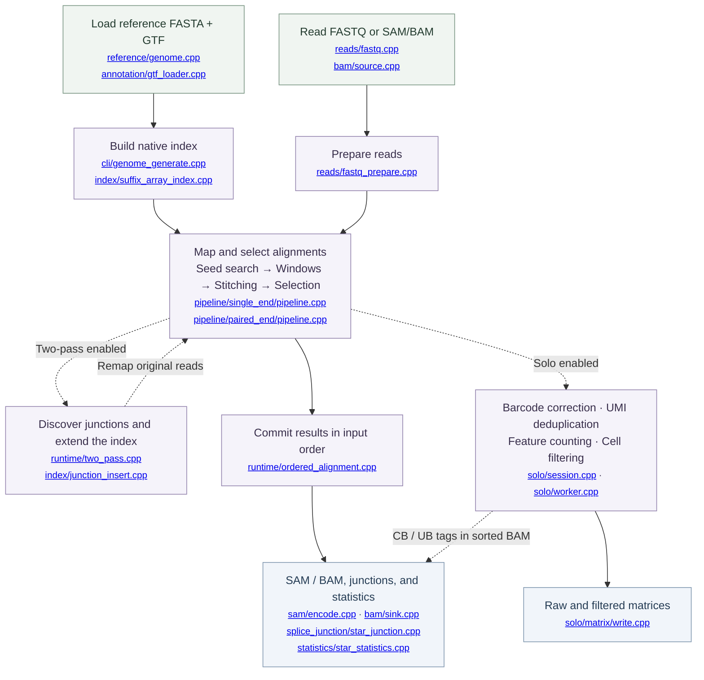

<div align="center">

# NuSTAR

**NuSTAR is a reimplementation of STAR, a popular RNA-seq aligner.**
<a id="contents"></a>

<p align="center">
  <a href="#quick-start">Quick start</a> &nbsp;·&nbsp;
  <a href="#usage-and-parameters">Usage</a> &nbsp;·&nbsp;
  <a href="#implementation-status-and-roadmap">Implementation Status and Roadmap</a> &nbsp;·&nbsp;
  <a href="#benchmarks">Benchmarks</a>
  <br>
  <a href="#ai-use-and-review">AI use and review</a> &nbsp;·&nbsp;
  <a href="#questions-and-contributions">Questions and contributions</a> &nbsp;·&nbsp;
  <a href="#acknowledgments-and-references">References</a>
</p>

</div>

---

NuSTAR supports single-end and paired-end reads, overlap refinement, two-pass mapping, and STARsolo.

> [!IMPORTANT]
> Use a **native NuSTAR index** and **uncompressed FASTQ reads**.

<a id="quick-start"></a>

## Quick start <sup><sub>[↑ Contents](#contents)</sub></sup>

<a id="1-build"></a>

### 1. Build <sup><sub>[↑ Contents](#contents)</sub></sup>

Requires **CMake 3.20+**, **C++20 and C99 compilers**, **zlib development files**, and **Python 3**. OpenMP is optional; HTSlib and libsais are bundled.

```sh
git clone https://github.com/BioCode-Commons/NuSTAR.git
cd NuSTAR

cmake -S . -B build/release -DCMAKE_BUILD_TYPE=Release
cmake --build build/release -j 8
ctest --test-dir build/release --output-on-failure
```

<details>
<summary><strong>Build configuration</strong></summary>

Disable release IPO with `-DNUSTAR_ENABLE_RELEASE_IPO=OFF`. To build without tests, use `-DBUILD_TESTING=OFF` and skip `ctest`; Python is then optional.

</details>

<a id="2-build-a-genome-index"></a>

### 2. Build a genome index <sup><sub>[↑ Contents](#contents)</sub></sup>

Supply a reference FASTA and matching GTF.

```sh
build/release/nustar --runMode genomeGenerate \
  --genomeDir index/human \
  --genomeFastaFiles reference/GRCh38.fa \
  --sjdbGTFfile reference/genes.gtf \
  --sjdbOverhang 100 \
  --runThreadN 8
```

Set `--sjdbOverhang` to read length minus one. Solo gene counting needs GTF annotation tables; small genomes need a smaller `--genomeSAindexNbases`.

<a id="3-align-paired-end-reads"></a>

### 3. Align paired-end reads <sup><sub>[↑ Contents](#contents)</sub></sup>

```sh
mkdir -p results

build/release/nustar --genomeDir index/human \
  --readFilesIn mate1.fastq mate2.fastq \
  --runThreadN 8 \
  --outFileNamePrefix results/sample. \
  --outSAMtype BAM SortedByCoordinate \
  --outSAMunmapped Within \
  --limitBAMsortRAM 2147483648
```

Produces sorted BAM, splice junctions, and mapping statistics. See [usage and parameters](#usage-and-parameters) for single-end, two-pass, overlap, and single-cell workflows.

<a id="usage-and-parameters"></a>

## Usage and parameters <sup><sub>[↑ Contents](#contents)</sub></sup>

<details>
<summary><strong>Workflows, outputs, and parameter reference</strong></summary>

Run the examples from the repository root after building `build/release/nustar` and creating a NuSTAR index. Supply your own input files and create the output parent directory, such as `results/`, before running a command.

<a id="workflows"></a>

## Workflows <sup><sub>[↑ Contents](#contents)</sub></sup>

### Single-end alignment

```sh
build/release/nustar --genomeDir index/human \
  --readFilesIn reads.fastq \
  --runThreadN 8 \
  --outFileNamePrefix results/single.
```

The default alignment output is SAM. Use `--outSAMtype None` to retain junctions, statistics, and requested Solo counts without writing alignment records.

### Two-pass alignment

Add the following options to a single-end or paired-end alignment command:

```sh
--twopassMode Basic --twopass1readsN -1 --sjdbInsertSave Basic
```

Pass one discovers junctions. NuSTAR inserts accepted junction sequences into the index, then rereads the input for pass two.

- `--twopass1readsN -1` uses all reads in pass one; a positive value limits that pass.
- `--sjdbInsertSave All` also saves the updated native index.
- Input must remain available for both passes.

### Overlapping paired-end reads

To enable overlap merge/remapping, add these options to a paired-end command:

```sh
--peOverlapNbasesMin 20 --peOverlapMMp 0.01
```

`20` is an example overlap threshold, not a benchmark-derived recommendation. The default `--peOverlapNbasesMin 0` disables the helper. `--peOverlapMMp` defaults to `0.01` and accepts values greater than or equal to zero and less than one. The overlap search counts ambiguous bases as mismatches and uses mismatches divided by matches, following STAR's rule.

NuSTAR maps a merged sequence in a separate workspace, projects its blocks back to the two mates, and recalculates paired scores before selection. Original read sequences remain available for SAM/BAM output. This is a paired-end mapping feature, not adapter clipping.

### Single-cell: 10x 3′ v3

For this layout, **R2 contains RNA** and **R1 contains a 16-base cell barcode followed by a 12-base UMI**. Supply the barcode FASTQ last and use the whitelist for your chemistry.

```sh
build/release/nustar --genomeDir index/human \
  --readFilesIn RNA_R2.fastq barcode_R1.fastq \
  --soloType CB_UMI_Simple \
  --soloCBwhitelist whitelist.txt \
  --soloCBstart 1 --soloCBlen 16 \
  --soloUMIstart 17 --soloUMIlen 12 \
  --soloBarcodeReadLength 0 \
  --soloFeatures Gene \
  --soloCellFilter EmptyDrops_CR \
  --runThreadN 8 \
  --outFileNamePrefix results/cells. \
  --outSAMtype BAM SortedByCoordinate \
  --outSAMattributes NH HI AS nM CR CY UR UY CB UB GX GN
```

Raw and filtered matrices appear under `results/cells.Solo.out/`, grouped by feature. `--soloBarcodeReadLength 0` disables the exact barcode-read length check; the selected barcode and UMI positions must still exist. For a typical v2 layout, the UMI length is 10 rather than 12.

> [!NOTE]
> Corrected `CB`/`UB` tags in counting modes require `BAM SortedByCoordinate`, because correction finishes after counting all reads. `CR`/`CY` and `UR`/`UY` contain the raw barcode/UMI sequences and qualities.

<details>
<summary><strong>Remap SAM/BAM input</strong></summary>

```sh
build/release/nustar --genomeDir index/human \
  --readFilesIn input.bam \
  --readFilesType SAM SE \
  --readFilesSAMattrKeep All \
  --outSAMtype BAM SortedByCoordinate \
  --outFileNamePrefix results/remapped.
```

Despite the option name, NuSTAR detects and reads both SAM and BAM directly. It **remaps the sequences**, rather than only converting the format.

Use `SAM PE` for paired input. Paired records must be adjacent, share the same read name, and have complementary mate flags; coordinate-sorted paired BAM usually needs name grouping first. Each record needs sequence and quality data. Secondary and supplementary records are not implicitly discarded.

For barcodes already stored in SAM/BAM tags, add:

```sh
--soloType CB_UMI_Simple --soloCBwhitelist whitelist.txt \
--soloInputSAMattrBarcodeSeq CR UR --soloInputSAMattrBarcodeQual CY UY
```

</details>

<details>
<summary><strong>Analyze SmartSeq reads</strong></summary>

Provide a tab-separated manifest with three columns: mate 1 path, mate 2 path (or `-` for single-end), and cell/read-group information. Do not mix single-end and paired-end rows.

```sh
build/release/nustar --genomeDir index/human \
  --readFilesManifest cells.tsv \
  --soloType SmartSeq \
  --soloUMIdedup Exact \
  --soloCellFilter None \
  --outSAMtype None \
  --outFileNamePrefix results/smartseq.
```

</details>

<details>
<summary><strong>Filter an existing raw matrix</strong></summary>

Cell filtering can run independently of read alignment:

```sh
build/release/nustar --runMode soloCellFiltering \
  results/cells.Solo.out/Gene/raw results/refiltered/ \
  --soloCellFilter TopCells 3000
```

</details>

<a id="outputs"></a>

## Outputs <sup><sub>[↑ Contents](#contents)</sub></sup>

Paths below are appended to `--outFileNamePrefix`. Alignment files depend on the selected output mode; Solo matrices require a counting workflow.

| Output | Contents |
| :--- | :--- |
| `Aligned.out.sam` | SAM alignment records; default output |
| `Aligned.out.bam` | Unsorted BAM records |
| `Aligned.sortedByCoord.out.bam` | Coordinate-sorted BAM records |
| `SJ.out.tab` | Splice-junction observations |
| `Log.final.out` | Mapping statistics |
| `Solo.out/<feature>/raw/` | Raw feature-by-barcode matrix files |
| `Solo.out/<feature>/filtered/` | Filtered matrix files when cell filtering is enabled |

Request both BAM orders with `--outSAMtype BAM Unsorted SortedByCoordinate`. BAM index files (`BAI`/`CSI`) are not generated.

<a id="compatibility"></a>

## Compatibility <sup><sub>[↑ Contents](#contents)</sub></sup>

NuSTAR follows STAR option names and argument forms where implemented. It is a partial implementation; a successful comparison on one dataset does not establish compatibility with all STAR workflows.

| Area | Implemented | Missing or limited |
| --- | --- | --- |
| Index | FASTA/GTF loading, packed suffix array, annotation tables, incremental junction insertion | Loading STAR's binary index; STAR shared-memory load/remove modes. |
| Mapping | Single-end and paired-end spliced alignment, seed/window/stitch/select stages, fixed clipping, optional paired overlap merge/remapping, `Basic` two-pass | Chimeric/fusion alignment, WASP/VCF workflows, adapter clipping, most configurable STAR scoring and filtering options. |
| Input | Plain FASTQ; direct SAM/BAM; SmartSeq manifests | Compressed FASTQ, FASTA reads, comma-separated file groups, `readFilesCommand`, general manifest input outside SmartSeq. |
| Output | SAM, unsorted/sorted BAM, junction tables, mapping statistics | CRAM as a supported interface, BAI/CSI generation, transcriptome BAM, bulk `GeneCounts`, signal tracks, all STAR header/tag customization. BAM read names are limited to 254 bytes and CIGARs to 65,535 operations. |
| Solo | Barcode extraction/correction, UMI deduplication, gene/SJ/velocity counting, cell filtering, matrix output, SmartSeq, corrected BAM tags | Full validation of every mode/parameter combination on real single-cell datasets; `Transcript3p` remains less tested. |
| Parallelism and profiling | Shared read-only index, worker-local workspaces, ordered output, BAM compression/sorting, stage timing | Detailed paired-end stage timing. |

<a id="parameter-reference"></a>

## Parameter reference <sup><sub>[↑ Contents](#contents)</sub></sup>

Use `--runThreadN`, `--runMode`, `--readFilesIn`, and `--outFileNamePrefix`. The legacy `--threads` alias and positional `alignSingleSam`, `alignPairedSam`, `genomeGenerate`, and `build-index` commands have been removed.

Expand a group for defaults, accepted values, and constraints.

<details>
<summary><strong>Shared and index options</strong></summary>

| Option | Default | Use |
| --- | --- | --- |
| `--help`, `--version` | — | Print help or the NuSTAR version; use either on its own. |
| `--runMode` | `alignReads` | `alignReads`, `genomeGenerate`, or `soloCellFiltering RAW_DIR OUTPUT_PREFIX`. |
| `--runThreadN N` | `1` | Worker count, from 1 to 256 for mapping and index building. |
| `--genomeDir DIR` | `./GenomeDir/` | Native index directory. |
| `--genomeFastaFiles FILE...` | required for index building | One or more reference FASTA files. |
| `--sjdbGTFfile FILE` | `-` | GTF used during index building; `-` means no GTF. |
| `--sjdbOverhang N` | `100` | Junction flank length, used when building or extending the index. |
| `--genomeChrBinNbits N` | `18` | Chromosome padding/bin bits, 8–30. |
| `--genomeSAindexNbases N` | `14` | SA prefix length, 1–15. Reduce for small genomes. |
| `--limitSjdbInsertNsj N` | `1000000` | Total junction count after insertion, including existing junctions. Choose a value large enough for the intended annotation and discovered junctions; this is not a current benchmark result. |
| `--sjdbGTFchrPrefix TEXT` | `-` | Prefix for GTF chromosome names; `-` adds nothing. |
| `--sjdbGTFfeatureExon NAME` | `exon` | GTF feature used as an exon. |
| `--sjdbGTFtagExonParentTranscript NAME` | `transcript_id` | Transcript attribute. |
| `--sjdbGTFtagExonParentGene NAME` | `gene_id` | Gene ID attribute. |
| `--sjdbGTFtagExonParentGeneName NAME...` | `gene_name` | Gene name attributes. |
| `--sjdbGTFtagExonParentGeneType NAME...` | `gene_type gene_biotype` | Gene type attributes. |

</details>

<details>
<summary><strong>Alignment and output options</strong></summary>

| Option | Default | Use |
| --- | --- | --- |
| `--peOverlapNbasesMin N` | `0` | Minimum overlap for paired merge/remapping; zero disables it. Mapping option, not an index-build setting. |
| `--peOverlapMMp F` | `0.01` | Overlap mismatch/match ratio; `0 <= F < 1`. |
| `--readFilesIn FILE...` | required unless using a manifest | One or two RNA FASTQ files, followed by a separate barcode file when needed; or one SAM/BAM file. |
| `--readFilesManifest FILE` | none | SmartSeq input groups. |
| `--readFilesType Fastx` or `SAM SE/PE` | `Fastx` | FASTQ, or SAM/BAM with the specified mate layout. FASTA reads are not implemented. |
| `--readFilesSAMattrKeep TAG...` | `All` | BAM input tags to retain: `All`, `None`, or tag names. The SAM text reader currently retains all input tags. |
| `--readMapNumber N` | `-1` | Maximum reads/fragments to map; `-1` means all. |
| `--clip5pNbases N...`, `--clip3pNbases N...` | `0` | Fixed clipping at each end. Supply both mate values for paired reads. |
| `--outFileNamePrefix PREFIX` | `./` | Prefix for output paths. |
| `--outSAMtype` | `SAM` | `SAM`, `None`, or `BAM` followed by `Unsorted`, `SortedByCoordinate`, or both. |
| `--outSAMattributes TAG...` | `Standard` | `Standard` expands to `NH HI AS nM`; otherwise list tags explicitly. |
| `--outSAMunmapped MODE` | `None` | `None` or `Within`; `KeepPairs` is not implemented. |
| `--outSAMorder MODE` | `Paired` | `Paired` or `PairedKeepInputOrder`. NuSTAR commits unsorted batches in input order in either mode. |
| `--outBAMcompression N` | `1` | BGZF compression level, -1 through 9. |
| `--limitBAMsortRAM BYTES` | `268435456` | Sort-record budget, not a total-process memory limit. Zero also selects 256 MiB in NuSTAR. |
| `--twopassMode MODE` | `None` | `None` or `Basic`. |
| `--twopass1readsN N` | `-1` | First-pass read limit; use `-1` or a positive count. |
| `--sjdbInsertSave MODE` | `Basic` | `Basic` or `All`; `All` saves the updated index. |

Ordinary output tags are `NH HI AS nM RG`. Single-end mapping also supports `NM MD jM jI XS`. Solo adds `CR CY UR UY CB UB GX GN sM sS sQ sF`. `GX`/`GN` currently require Solo. `outSAMattributes None` and `All` are not implemented.

BAM sorting spills runs to disk. During mapping, the record cache is capped at the smaller of the requested sort budget and 8 MiB per thread; other buffers and the genome index consume additional memory. The `limitBAMsortRAM 0` behavior differs from STAR's automatic budget choice.

</details>

<details>
<summary><strong>Solo options</strong></summary>

These options apply to an enabled Solo mode. Defaults are in [solo/configuration/defaults.hpp](solo/configuration/defaults.hpp).

| Option | Default | Use |
| --- | --- | --- |
| `--soloType MODE` | `None` | `None`, `CB_UMI_Simple`, `CB_UMI_Complex`, `CB_samTagOut`, or `SmartSeq`. `CB_samTagOut` writes barcode tags without matrix counting. |
| `--soloCBtype TYPE` | `Sequence` | `Sequence` or `String`; string barcodes require `--soloCBwhitelist None`. |
| `--soloCBwhitelist FILE...` | `-` | Barcode whitelist(s); `None` disables matching for simple layouts. The default `-` means no file was supplied and is not valid for simple-layout counting. |
| `--soloCBstart N`, `--soloCBlen N` | `1`, `16` | Simple-layout CB start (1-based) and length. |
| `--soloUMIstart N`, `--soloUMIlen N` | `17`, `10` | Simple-layout UMI start (1-based) and length. |
| `--soloBarcodeReadLength N` | `1` | `1`: require CB length + UMI length; `0`: skip exact length check; larger values: required length. |
| `--soloBarcodeMate N` | `0` | `0`: separate barcode file; `1` or `2`: barcode is in an RNA mate. Set fixed clipping for that mate. |
| `--soloCBposition DESCRIPTOR...` | `-` | Complex-layout CB pieces in STAR's `anchor_offset_anchor_offset` form. |
| `--soloUMIposition DESCRIPTOR` | `-` | Complex-layout UMI position. |
| `--soloAdapterSequence SEQUENCE` | `-` | Adapter anchor for complex layouts. |
| `--soloAdapterMismatchesNmax N` | `1` | Allowed adapter mismatches. |
| `--soloCBmatchWLtype MODE` | `1MM_multi` | `Exact`, `1MM`, `1MM_multi`, `1MM_multi_pseudocounts`, `1MM_multi_Nbase_pseudocounts`, or complex-layout `EditDist_2`. |
| `--soloInputSAMattrBarcodeSeq TAG...` | `-` | Input sequence tags, commonly `CR UR`. |
| `--soloInputSAMattrBarcodeQual TAG...` | `-` | Input quality tags, commonly `CY UY`. |
| `--soloStrand MODE` | `Forward` | `Forward`, `Reverse`, or `Unstranded`. |
| `--soloFeatures FEATURE...` | `Gene` | `Gene`, `GeneFull`, `GeneFull_Ex50pAS`, `GeneFull_ExonOverIntron`, `SJ`, `Velocyto`, `VelocytoSimple`, or `Transcript3p`. |
| `--soloMultiMappers MODE...` | `Unique` | `Unique`, `Uniform`, `Rescue`, `PropUnique`, or `EM`. |
| `--soloUMIdedup MODE...` | `1MM_All` | `Exact`, `1MM_All`, `1MM_Directional`, `1MM_Directional_UMItools`, `1MM_CR`, or `NoDedup`. |
| `--soloUMIfiltering MODE` | `-` | `-`, `MultiGeneUMI`, `MultiGeneUMI_All`, or `MultiGeneUMI_CR`. The last requires `1MM_CR` deduplication. |
| `--soloCellFilter MODE ...` | `CellRanger2.2 3000 0.99 10` | `None`, `TopCells N`, `CellRanger2.2`, or `EmptyDrops_CR`. Numeric settings are described below. |
| `--soloOutFileNames DIR FEATURES BARCODES MATRIX` | `Solo.out/ features.tsv barcodes.tsv matrix.mtx` | Output directory suffix and matrix component names. |
| `--soloOutFormatFeaturesGeneField3 TEXT` | `Gene Expression` | Third field of gene feature rows; quote text containing spaces. |
| `--soloCellReadStats MODE` | `None` | `None` or `Standard`. |
| `--soloClusterCBfile FILE` | `-` | Barcode clusters for `Transcript3p` counting. This path has less validation than gene counting. |

Custom `--runRNGseed` values are not supported.

Not every combination is valid. For example, `CB_UMI_Complex` uses `Exact`, `1MM`, or `EditDist_2` matching; `CB_samTagOut` uses `Exact` or `1MM`. SmartSeq does not support `Velocyto` or multimapper redistribution. Check the error message when choosing a non-default combination.

`CellRanger2.2` accepts three numbers: expected cells, maximum percentile, and maximum/minimum ratio. Supplying the mode alone uses `3000 0.99 10`.

`EmptyDrops_CR` accepts ten numbers in this order: expected cells, maximum percentile, maximum/minimum ratio, lower ambient rank, upper ambient rank, minimum UMI count, minimum fraction of median UMIs, maximum candidate count, FDR, and simulation count. Its defaults are `3000 0.99 10 45000 90000 500 0.01 20000 0.01 10000`.

</details>

<details>
<summary><strong>NuSTAR-only controls</strong></summary>

| Option or command | Use |
| --- | --- |
| `--io-backend mmap` or `buffered` | FASTQ transport; default `mmap`. |
| `--profile-stages` | Detailed mapping-stage timing, currently single-end only. |
| `--profile-runtime` | Runtime timing for single-end or paired-end runs. |
| `--profileGenomeGenerate` | Index-building timing. |
| `upgradeIndex SOURCE_DIR NEW_DIR` | Upgrade an older native index without rebuilding the suffix array. |

These controls have no direct STAR equivalent. Benchmark and trace scripts also have their own tool-specific arguments; use their `--help` output.

</details>

</details>

<a id="codebase"></a>
<a id="implementation-status-and-roadmap"></a>

## Implementation Status and Roadmap <sup><sub>[↑ Contents](#contents)</sub></sup>

NuSTAR implements reference indexing, spliced alignment, two-pass mapping, and single-cell counting. The flow below shows how these parts fit together, with the main `.cpp` entry points in each box. Click a filename to open that source file. Dashed paths are optional.



Paired-end mapping can refine overlapping mates before selection. Two-pass mapping reruns the reads after index extension. Solo finishes counting before corrected `CB`/`UB` tags are written to sorted BAM.

| Feature | Status | What it covers |
| :--- | :--- | :--- |
| Reference indexing | Implemented | FASTA/GTF loading, packed suffix arrays, and gene/junction annotations |
| Bulk alignment | Implemented | Single-end and paired-end spliced mapping, fixed clipping, and optional mate-overlap refinement |
| Two-pass mapping | Implemented | Junction discovery, index extension, and remapping from the original reads |
| Single-cell analysis | Integrated from STARsolo | Barcode correction, UMI deduplication, gene/SJ/velocity counts, cell filtering, and SmartSeq |
| Input and output | Implemented | Plain FASTQ, SAM/BAM remapping, SAM, unsorted/sorted BAM, junctions, and mapping statistics |

### Inside NuSTAR

- **Index construction:** [libsais64](index/wide_suffix_array.cpp) builds the suffix array. Packing releases consumed temporary pages on Linux; prefix tables are built after the temporary array is freed.
- **Mapping stages:** seed search, window construction, stitching, and selection exchange explicit results. Each worker reuses its own workspace; the [window builder](window/star_window.cpp) tracks and resets only touched bins.
- **Two-pass index extension:** the [suffix-array merge](index/junction_insert.cpp) splits output ranks into independent chunks. Workers find their starting insertion by binary search and write separate packed ranges.
- **Output:** the runtime commits results in input order. [BAM sorting](bam/sink.cpp) writes bounded runs to disk and merges them with a priority queue.

See [supported modes and limits](#usage-and-parameters).

<a id="code-guide"></a>
<details>
<summary><strong>Execution flow and module guide</strong></summary>

Start with [cli/align_reads.cpp](cli/align_reads.cpp). It turns command-line arguments into a run configuration and chooses the single-end or paired-end runner. The alignment algorithms live below that layer; they do not parse arguments or open output files.

Most alignment code uses the namespace `nustar::star2711b`. Stage implementations share a read-only reference and keep per-worker workspaces.

<a id="from-a-read-to-an-alignment"></a>

## From a read to an alignment <sup><sub>[↑ Contents](#contents)</sub></sup>

The overview above shows the main stages. The table below links each stage to its implementation.

The Solo steps run only when requested. A run without alignment output still computes the alignments needed for junctions, statistics, and counting.

| Step | Read these files | What the code does |
| --- | --- | --- |
| Parse the command | [cli/main.cpp](cli/main.cpp), [cli/align_reads.cpp](cli/align_reads.cpp) | Select a run mode, parse STAR-style arguments, and choose the mate layout and output format. |
| Set up a run | [runtime/single_alignment.cpp](runtime/single_alignment.cpp), [runtime/paired_alignment.cpp](runtime/paired_alignment.cpp) | Open reference/index resources, connect the input and output, create Solo state if needed, and run the worker loop. |
| Read fragments | [reads/fastq.cpp](reads/fastq.cpp), [reads/dispatch.cpp](reads/dispatch.cpp), [bam/source.cpp](bam/source.cpp) | Read FASTQ or SAM/BAM and form one fragment containing one or two RNA reads. SAM/BAM input is converted back to read orientation before remapping. |
| Prepare bases | [reads/fastq_prepare.cpp](reads/fastq_prepare.cpp) | Apply fixed clipping and create the encoded sequence views used by mapping. |
| Find seeds | [seed_search/star_search.cpp](seed_search/star_search.cpp) | Search the suffix array for maximal mappable pieces, retaining read positions, lengths, and match intervals. |
| Build windows | [window/star_window.cpp](window/star_window.cpp) | Place seed hits into genomic bins, form candidate windows, and arrange their seeds and anchors for stitching. |
| Stitch candidates | [stitching/single_stitch.cpp](stitching/single_stitch.cpp), [stitching/paired_stitch.cpp](stitching/paired_stitch.cpp), [stitching/stitch_window.cpp](stitching/stitch_window.cpp) | Explore compatible seed chains within each window. Paired stitching also handles the relationship between mates. |
| Extend a chain | [stitching/stitch_segments.cpp](stitching/stitch_segments.cpp), [stitching/extend_alignment.cpp](stitching/extend_alignment.cpp) | Extend matches and score mismatches, indels, and splice junctions. |
| Choose alignments | [selection/star_select.cpp](selection/star_select.cpp) | Apply candidate selection and mapping filters, including multimapping decisions. |
| Describe results | [sam/star_single.cpp](sam/star_single.cpp), [sam/star_paired.cpp](sam/star_paired.cpp) | Project selected alignments into SAM fields and tags. These files do not compress BAM. |
| Gather side results | [splice_junction/star_junction.cpp](splice_junction/star_junction.cpp), [statistics/star_statistics.cpp](statistics/star_statistics.cpp) | Collect junction observations and mapping counters from the same mapping result. |
| Write records | [sam/encode.cpp](sam/encode.cpp), [output/file_sink.cpp](output/file_sink.cpp), [bam/codec.cpp](bam/codec.cpp), [bam/sink.cpp](bam/sink.cpp) | Encode text or BAM records, write chunks, compress BGZF blocks, and sort BAM when requested. |

The stage order is wired in [pipeline/single_end/mapping_composition.cpp](pipeline/single_end/mapping_composition.cpp) and [pipeline/paired_end/mapping_composition.cpp](pipeline/paired_end/mapping_composition.cpp). Their neighboring `pipeline.cpp` files add selection, record projection, junctions, and statistics. This is the place to review how one stage's output becomes the next stage's input.

<a id="overlapping-mates"></a>

## Overlapping mates <sup><sub>[↑ Contents](#contents)</sub></sup>

[pipeline/paired_end/star_overlap.cpp](pipeline/paired_end/star_overlap.cpp) implements `peOverlapNbasesMin` and `peOverlapMMp`. The paired pipeline calls it after ordinary paired candidate mapping and before selection. It searches the two mate offsets using STAR's match/mismatch rule, maps a merged read with a separate single-read workspace, projects blocks back into paired coordinates, and recalculates the paired scores. The original sequences remain available for SAM/BAM output.

[runtime/paired_alignment.cpp](runtime/paired_alignment.cpp) creates this helper only when overlap is enabled. It shares the seed finder, window builder and reference with the normal mapper. The helper does not invoke a complete single-end output pipeline or consume random selection state.

<a id="index-and-annotation"></a>

## Index and annotation <sup><sub>[↑ Contents](#contents)</sub></sup>

[cli/genome_generate.cpp](cli/genome_generate.cpp) coordinates index building. [reference/genome.cpp](reference/genome.cpp) owns the reference representation. [annotation/gtf_loader.cpp](annotation/gtf_loader.cpp) reads genes, transcripts, and exons; [annotation/junction_database.cpp](annotation/junction_database.cpp) builds the annotated junction data.

The default production suffix-array build calls bundled libsais through [index/wide_suffix_array.cpp](index/wide_suffix_array.cpp), selected by [index/suffix_array_index.cpp](index/suffix_array_index.cpp). The separate [index/sais.cpp](index/sais.cpp) implementation serves the 32-bit builder interface. [index/packed_suffix_array.cpp](index/packed_suffix_array.cpp) handles packed entries. [index/star_prefix.cpp](index/star_prefix.cpp) builds and queries the prefix search data. [index/star_rank.cpp](index/star_rank.cpp) preserves the required suffix ordering.

During construction, `PackedSuffixArray::packAndRelease` consumes the temporary 64-bit positions; on Linux it releases complete source pages as they are packed. Prefix ranges are built after that temporary SA is freed, and the CLI releases construction objects before reloading the saved index. This reduces simultaneous allocations without changing suffix ranks or the file format.

[index/suffix_array_index.cpp](index/suffix_array_index.cpp) loads and saves the native index. [index/backend.hpp](index/backend.hpp) is the interface used by mapping code. The index representation stays behind that interface so seed search does not need to know how files were opened.

The reference and index are shared between workers. Their owners keep the backing storage alive; per-read stages use views into it. Per-read scratch buffers belong to workers and are reused rather than recreated for each read.

<a id="two-pass-mapping"></a>

## Two-pass mapping <sup><sub>[↑ Contents](#contents)</sub></sup>

[runtime/two_pass.cpp](runtime/two_pass.cpp) runs pass one with junction collection, filters the junctions, extends the index, and starts pass two from the original input. [index/junction_insert.cpp](index/junction_insert.cpp) and [index/extension.cpp](index/extension.cpp) do the index update. Pass two uses the same mapping pipeline as an ordinary run.

The extended suffix-array merge partitions output ranks into independent packed ranges. Each worker binary-searches the first insertion for its range, merges the old and new entries, and releases consumed old-array pages. This keeps packed writes disjoint.

This split matters when changing the code: junction discovery belongs to the mapping run, while index insertion belongs to `index/`. The two-pass coordinator should not implement another seed search or stitcher.

<a id="solo"></a>

## Solo <sup><sub>[↑ Contents](#contents)</sub></sup>

Solo receives NuSTAR alignments. It does not run a second aligner.

| Directory or file | Responsibility |
| --- | --- |
| [solo/config.hpp](solo/config.hpp), [solo/session.hpp](solo/session.hpp) | Public configuration and run-level interface. The runtime uses these rather than the counting internals. |
| [solo/session.cpp](solo/session.cpp), [solo/worker.cpp](solo/worker.cpp) | Create shared and worker-local Solo state, adapt mapping results, finish counting, and make corrected tags available to BAM output. |
| [solo/configuration/](solo/configuration/) | Parse options, apply defaults, and check combinations. |
| [solo/barcode/](solo/barcode/) | Extract CB/UMI sequences, locate complex layouts, and match barcodes against whitelists. |
| [solo/annotation/](solo/annotation/) | Match alignment blocks to genes, exons, introns, and transcript features. |
| [solo/counting/](solo/counting/) | Record read assignments, merge workers, count features, and handle multimappers and SmartSeq. |
| [solo/umi/](solo/umi/) | Deduplicate UMIs using the selected rule. |
| [solo/filtering/](solo/filtering/) | Select cells, including EmptyDrops-style filtering. |
| [solo/matrix/](solo/matrix/) | Load and write matrices and summaries. |
| [solo/filter.cpp](solo/filter.cpp) | Run cell filtering on an existing matrix without mapping reads. |
| [solo/support/](solo/support/) | Small helpers shared by the Solo implementation. |

For example, [solo/annotation/alignment.cpp](solo/annotation/alignment.cpp) contains `Alignment::extractSpliceJunctions()`. It walks adjacent exon blocks, skips indels and mate gaps, and records intron starts and lengths. `chrStartLengthExtended()` computes an extended interval used by annotation. These functions describe an existing alignment; they do not choose how reads align.

Corrected `CB`/`UB` tags can depend on counts from later reads. Coordinate BAM output therefore retains the read identity and obtains final tags after Solo finishes. Raw barcode tags can be produced during mapping.

Solo's counting algorithms come from STAR. The source has been split into modules and adapted to NuSTAR's pipeline. [solo/UPSTREAM.json](solo/UPSTREAM.json) and [solo/STAR.LICENSE](solo/STAR.LICENSE) keep that origin visible.

<a id="threads-and-output-order"></a>

## Threads and output order <sup><sub>[↑ Contents](#contents)</sub></sup>

[runtime/ordered_alignment.cpp](runtime/ordered_alignment.cpp) owns the mapping worker loop. Input access is serialized when a worker takes a batch. The expensive mapping work runs outside that input lock.

Each worker has its own workspace, random state, and temporary output buffers. The reference and suffix array are shared read-only. Solo also has per-worker recording state, followed by a merge after mapping.

Batches get sequence numbers. Workers may finish in a different order, but output commits and junction/statistic reductions follow input order. File sinks can spool chunks concurrently and concatenate them later. At most twice the worker count of batches can be in flight, which bounds the reorder backlog when one batch is slow.

Coordinate sorting is a separate step in [bam/sink.cpp](bam/sink.cpp). It writes bounded runs and merges them, rather than keeping the whole BAM in memory. The runtime releases mapping resources it no longer needs before the remaining counting and sorting work; shared owners can keep resources alive longer, including during two-pass runs.

<a id="other-directories"></a>

## Other directories <sup><sub>[↑ Contents](#contents)</sub></sup>

| Directory | Responsibility |
| --- | --- |
| [common/](common/) | Shared result types, workspace contracts, and file identity helpers. |
| [profiling/](profiling/) | Stage and progress timing. Timings are observations, not inputs to mapping decisions. |
| [tools/trace/](tools/trace/) | Dump or replay stage inputs and outputs for inspection. |
| [tools/oracle/](tools/oracle/) | Build instrumented STAR binaries for stage comparisons. These are test tools, not runtime dependencies. |
| [tools/benchmark/](tools/benchmark/) | Compare runtimes and memory, with inputs and commands saved alongside results. |
| [tests/](tests/) | Unit tests, module-boundary checks, and comparisons against STAR. |
| [third_party/](third_party/) | libsais, HTSlib, and other imported code with their licenses. |

For a change to seed search, start with its stage test and then compare full alignments. For a change to counting, compare matrices as well as BAM tags. Equal final record counts alone can hide different alignments or gene assignments.

</details>

<a id="roadmap"></a>

### Roadmap <sup><sub>[↑ Contents](#contents)</sub></sup>

| Area | Planned work | Validation |
| :--- | :--- | :--- |
| Benchmarks | Publish runtime, peak memory, and output checks for the current implementation | Repeat runs with the same inputs and settings; report variation |
| Bulk RNA-seq | Expand single-end, paired-end, overlap, and thread-scaling tests | Check full alignment records, junctions, and mapping statistics |
| Two-pass mapping | Profile junction insertion and suffix-array merging | Check both passes and final alignments |
| Single-cell analysis | Cover more datasets, chemistries, and counting modes | Check raw/filtered matrices, summaries, and corrected tags |
| Input and output | Add compressed FASTQ and scope further output modes | Add regression tests for each supported workflow |

<a id="benchmarks"></a>

## Benchmarks <sup><sub>[↑ Contents](#contents)</sub></sup>

Measurements for the current implementation are pending. For datasets, hardware, performance, and output checks, see [benchmark details](BENCHMARKS.md).

<a id="ai-use-and-review"></a>

## AI use and review <sup><sub>[↑ Contents](#contents)</sub></sup>

| Item | Status |
| :--- | :--- |
| AI use | Assisted refactoring, tests, and documentation |
| Comprehensive human audit | Done |

<a id="questions-and-contributions"></a>

## Questions and contributions <sup><sub>[↑ Contents](#contents)</sub></sup>

Visit [BioCode Commons](https://biocode-commons.github.io/) for projects, contribution guidance, and contact information.

<a id="acknowledgments-and-references"></a>

## Acknowledgments and references <sup><sub>[↑ Contents](#contents)</sub></sup>

NuSTAR builds on [STAR](https://github.com/alexdobin/STAR) and STARsolo by Alexander Dobin and collaborators. Please cite the original work:

- [STAR: ultrafast universal RNA-seq aligner](https://doi.org/10.1093/bioinformatics/bts635). Dobin et al., *Bioinformatics*, 2013.
- [STARsolo: accurate, fast and versatile mapping/quantification of single-cell and single-nucleus RNA-seq data](https://doi.org/10.1101/2021.05.05.442755). Kaminow, Yunusov, and Dobin, *bioRxiv*, 2021.

<details>
<summary><strong>BibTeX references</strong></summary>

```bibtex
@article{Dobin2013STAR,
  author  = {Dobin, Alexander and Davis, Carrie A. and Schlesinger, Felix and Drenkow, Jorg and Zaleski, Chris and Jha, Sonali and Batut, Philippe and Chaisson, Mark and Gingeras, Thomas R.},
  title   = {{STAR}: ultrafast universal {RNA}-seq aligner},
  journal = {Bioinformatics},
  year    = {2013},
  volume  = {29},
  number  = {1},
  pages   = {15--21},
  doi     = {10.1093/bioinformatics/bts635},
  url     = {https://doi.org/10.1093/bioinformatics/bts635}
}

@misc{Kaminow2021STARsolo,
  author       = {Kaminow, Benjamin and Yunusov, Dinar and Dobin, Alexander},
  title        = {{STARsolo}: accurate, fast and versatile mapping/quantification of single-cell and single-nucleus {RNA}-seq data},
  year         = {2021},
  howpublished = {bioRxiv},
  note         = {Preprint},
  doi          = {10.1101/2021.05.05.442755},
  url          = {https://doi.org/10.1101/2021.05.05.442755}
}
```

</details>

Upstream attribution is recorded in [solo/UPSTREAM.json](solo/UPSTREAM.json); licenses for STAR-derived code, HTSlib, libsais, and Simple Good–Turing are retained in [solo/STAR.LICENSE](solo/STAR.LICENSE) and [third_party/](third_party/).
